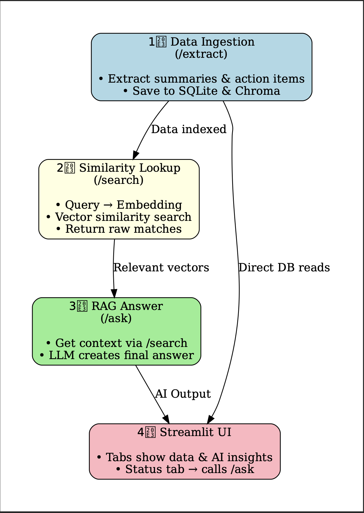

# Aurora – AI Leadership Copilot  

## 📌 Overview
Aurora is an AI-powered leadership copilot that helps Engineering Managers save time and communicate effectively.  
The **core extraction pipeline**: taking raw meeting text (transcripts or notes) and converting it into structured outputs:  
- ✅ **Decisions**  
- ✅ **Action Items**  
- ✅ **Blockers**  
---

## Deployed Services

# The frontend will be available at its own Render URL, such as https://aurora-leadership-copilot.onrender.com

# The backend will be available at its own Render URL https://aurora-leadership-copilot-backend.onrender.com/docs


## ⚙️ Setup Instructions
```bash
### 1. Clone Repository
git clone https://github.com/<your-username>/aurora-leadership-copilot.git
cd aurora-leadership-copilot

### 2. Create Virtual Environment
python -m venv .venv
source .venv/bin/activate   # Mac/Linux
.venv\Scripts\activate      # Windows

### 3. Install Dependencies
pip install -r requirements.txt

### 4. Ensure Ollama is Running
Install Ollama: https://ollama.ai

Start Ollama in background.

Test a model:
ollama run llama3.1 "Hello"

### Run Tests
python -m pytest
OR
python3 -m pytest --capture=no # to display print on terminal from test cases
python3 -m pytest --capture=no --disable-warnings # to disable warnings

### Run the application 
##locally

    #Activate your virtual environment (if not already): - python3 -m venv .venv
        source .venv/bin/activate
    #Install requirements:
        pip install -r requirements.txt
    #Add the open API key to .env file
        OPENAI_API_KEY=your-api-key # if the file doesn't exists please add it under main project same level as data directory
    #Run your FastAPI app from your project root:
        uvicorn main:app --reload --app-dir src
    ## Swagger available at http://127.0.0.1:8000/docs

---   
## Run the Stream Lit UI
    #Activate your virtual environment (if not already):
        python3 -m venv .venv
        source .venv/bin/activate
    # Install the requirements
        pip install -r requirements.txt
    # Will render on http://localhost:8501
        streamlit run streamlit_app/app.py

##  Run FastAPI Backend with Docker

1. Build the backend image:
   ```bash
   docker build -f Dockerfile.backend -t aurora-backend .
   ```
2. Run the backend container:
   ```bash
   docker run -p 8000:8000 -e OPENAI_API_KEY=your-api-key aurora-backend
   ```
   - Access FastAPI at: http://localhost:8000
   - Swagger docs: http://localhost:8000/docs

## Run Streamlit Frontend with Docker

1. Build the frontend image:
   ```bash
   docker build -f Dockerfile.frontend -t aurora-frontend .
   ```
2. Run the frontend container:
   ```bash
   docker run -p 8501:8501 aurora-frontend
   ```
   - Access Streamlit UI at: http://localhost:8501

## Run Both with Docker Compose (Recommended for Local)

1. Start both services:
   ```bash
   docker-compose up --build
   ```
2. Access:
   - FastAPI: http://localhost:8000
   - Streamlit: http://localhost:8501

## API's
    /search
        Purpose: Pure retrieval from the vector DB.
        What it does:

        Finds the most semantically similar items (clips, journals, meetings).

        Returns them as-is with metadata.

        When to use:

        You (or UI) just want to browse or preview raw matches.

        Example: “Show me all notes about API” → returns meeting summaries & clips mentioning API.

        Benefit:

        Transparent, fast, no LLM hallucinations.

        Great for debugging RAG or building dashboards (like smart clipboard history).
    /ask
        Purpose: RAG-style reasoning and synthesis.

        What it does:

        Uses /search internally to get relevant chunks.

        Feeds them into an LLM prompt.

        Returns a natural language answer.

        When to use:

        You want a direct, summarized answer instead of raw docs.

        Example: “What decisions were made about the API?” → AI answers using context. 


## 🧩 Conceptual Flow

### 1️⃣ Data Ingestion (`/extract`)
- **Endpoints:** `/meeting/extract`, `/clip/extract`, `/journal/extract`
- **Purpose:** Feed raw text (meeting transcripts, chat clips, journal entries) into the system.
- **Process:**
  - LLM extracts summary, action items, decisions, blockers.
  - Saves structured data in SQLite tables.
  - Adds text to Chroma vector DB for later retrieval.

---

### 2️⃣ Similarity Lookup (`/search`)
- **Purpose:** Find content similar to a user query.
- **Process:**
  - Query converted to embedding.
  - Compared against Chroma vectors.
  - Returns matching raw items with metadata (meeting, journal, clip).
- **Use Case:**  
  _“Show me all clips about API issues.”_  
  Useful for raw reference without LLM summarization.

---

### 3️⃣ RAG Answer (`/ask`)
- **Purpose:** Generate an AI answer using multiple sources.
- **Process:**
  - Internally calls `/search` to get relevant vectors.
  - Sends them to Ollama LLM with a prompt (e.g., “Summarize action items for API issues.”).
  - LLM produces a coherent, human-readable answer.
- **Use Case:**  
  _“What should I do this week based on my meetings and journals?”_  
  Drives smart summaries, weekly status report, and meeting trackers.

---

### 4️⃣ Streamlit UI Integration
- **Sidebar Tabs:**
  - **Clipboard:** Shows `/search` results for clips.
  - **Meetings:** Shows meetings + action items (from DB).
  - **Journal:** Shows journals + decisions/action items.
  - **Status Report:** Calls `/ask` to generate weekly summaries.
- **Key Idea:**
  - `/extract` → Ingest & save
  - `/search` → Quick reference / history
  - `/ask` → AI-generated insights & summaries

---

### UI Flow

Sidebar

    Title: AI Productivity Hub 
    
    HomePage : Dashboard 

    Navigation options:

    📋 Clipboard History (Clips)

    📅 Meetings
        Action Items
        Blockers
        Decisions

    📔 Journals

    📊 Weekly Status Reports

    🔍 Search

    🤖 Ask Assistant


[📄 View the Flow in PFD ](./docs/system_flow_diagram.pdf)



